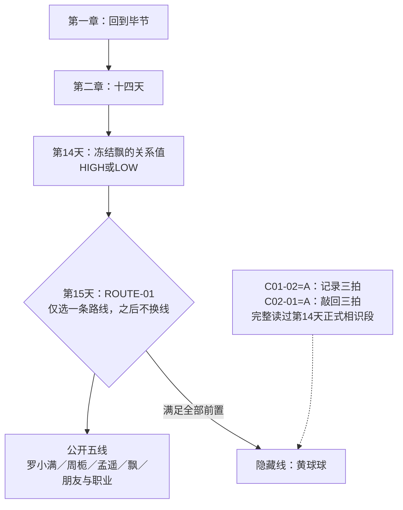
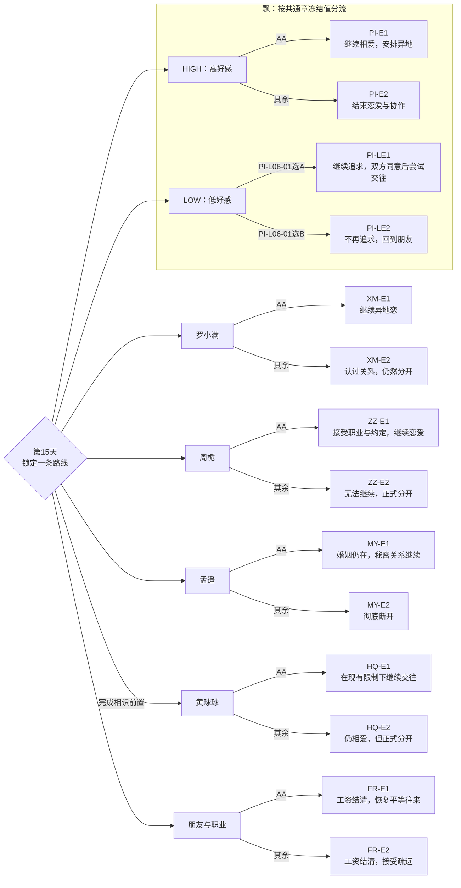
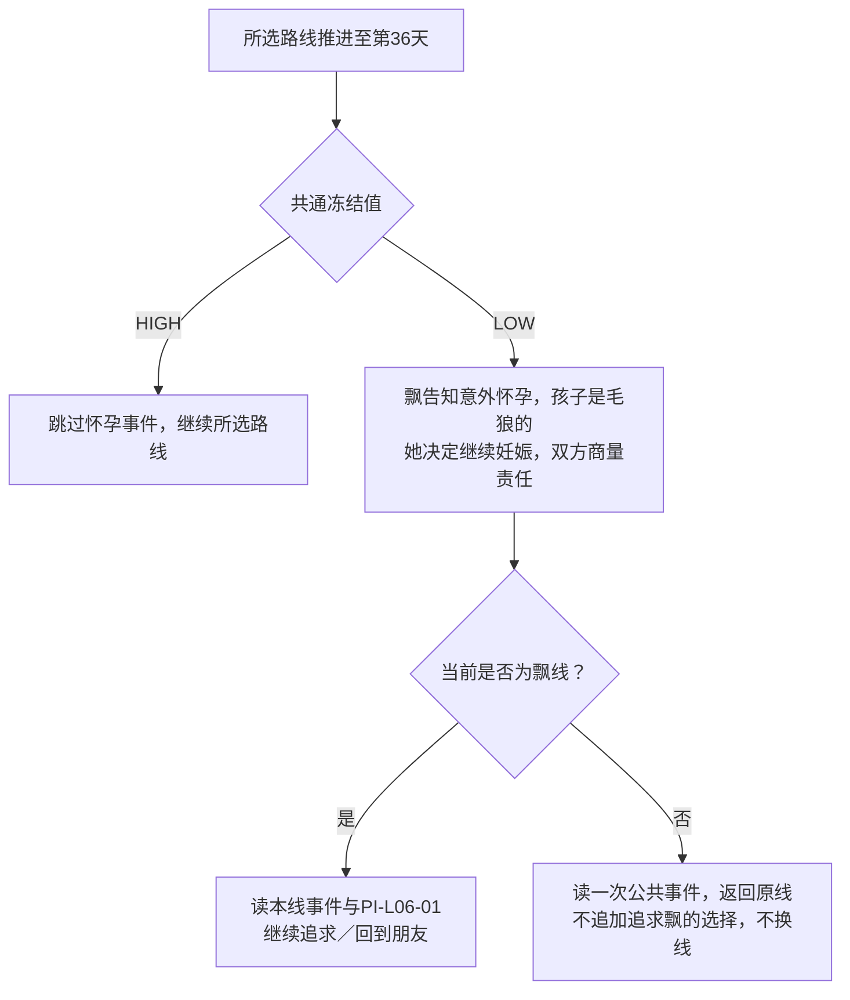
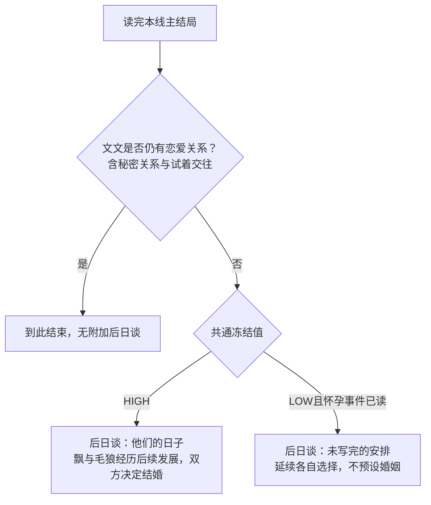

# 《毕节，雨停之前》故事分支图

更新：2026-11-02｜含完整结局剧透。按当前 `scenario/` 正文及 [routes.json](../../scenario/routes.json) 整理，共六条互斥路线、十四个主线结局。叶岚仅为普通游戏队友，无攻略路线与独立结局。

## 共通章与选线

- 飘好感初始20分；仅共通的 `C01-06`、`C02-08`、`C02-09` 计分，每处A加10、B减5。第14天第三处结束后，35分及以上为HIGH，其余为LOW；等价于三次中至少两次A为HIGH。选线和后续选择均不重算。
- 黄球球的三个前置须全部满足；`C02-07` 的A／B均不影响开放。未解锁时仅有五条公开路线。
- 普通表达选择保留当场回应，不改变主线结局；末章表达也不能翻转此前关键选择。

## 六路线与十四个主线结局

图中AA指本线两次关键选择依次都选A；“其余”指AB、BA、BB。飘LOW另用单次选择，不套用AA规则。E1／E2是结局编号，不代表统一的道德评价。

### 决定结局的关键选择

下表为行为概括；完整选项以 [选择设计](../../scenario/选择设计.md) 与各线正文为准。

| 路线 | 第一次关键选择：A／B | 第二次关键选择：A／B |
| --- | --- | --- |
| 罗小满 | `XM07-01`：共同收回酒账谎话／继续编理由护面子 | `XM08-01`：愿意继续异地／承认维持不了 |
| 周栀 | `ZZ06-01`：离开消费竞争，下班谈／当众点单争夺她 | `ZZ08-01`：接受她仍可能陪酒／承认无法接受 |
| 孟遥 | `MY07-01`：知情后继续私见／停止私见 | `MY09-01`：回应秘密关系的实际条件／结束私人联系 |
| 飘HIGH | `PI06-01`：亲自对外澄清、承担核对／请她处理外部误会 | `PI08-01`：坦白挽留、请求安排异地／结束恋爱中的等待 |
| 黄球球 | `HQ07-01`：放弃临时工钱，按约出现／先接工作再解释 | `HQ08-01`：接受限制，只承诺能做到的相处／承认无法接受 |
| 朋友与职业 | `FR06-01`：核账并当面修复伤害／只把结薪写清 | `FR08-01`：办好工作后主动约见／交接后停下私人关系 |
| 飘LOW | `PI-L06-01`：继续追求，听她意愿／不再追求，回到朋友 | 无第二次结局关键选择 |

任一B都会进入相应E2，但AB、BA、BB保留不同前因。孟遥的AA不是公开复合或自动离婚；BA也不能重启第七章已经停止的亲密。

### 正文中的正式结局标题

| 路线／路径 | E1 | E2 |
| --- | --- | --- |
| 罗小满 | `XM-E1`：出了这个圈，也来找我 | `XM-E2`：认过，也能分开 |
| 周栀 | `ZZ-E1`：不用哄我，也别骗我 | `ZZ-E2`：这句是真的，可惜晚了 |
| 孟遥 | `MY-E1`：还没有写出的名字 | `MY-E2`：旧题到这里 |
| 飘HIGH | `PI-E1`：这句不改 | `PI-E2`：空白页归还 |
| 飘LOW | `PI-LE1`：慢慢对焦 | `PI-LE2`：留一张给朋友 |
| 黄球球 | `HQ-E1`：门里也有明天 | `HQ-E2`：最后一次三下 |
| 朋友与职业 | `FR-E1`：换个地方，照样吃饭 | `FR-E2`：清账以后 |

## 第36天的跨路线事件

这是各路线推进至第36天时的条件事件，不是第15天选线前发生的事，也不是新增路线。

飘与毛狼不因怀孕自动恋爱或结婚；文文的选择不代替飘决定妊娠、恋爱与生活安排。调用与返回锚点见 [规则契约](../../scenario/规则契约.md)。

## 主线结局后的接续

2026-11-02调整为只接文文单身结局：XM-E1、ZZ-E1、MY-E1、PI-E1、PI-LE1、HQ-E1均不进入；XM-E2、ZZ-E2、MY-E2、PI-E2、PI-LE2、HQ-E2、FR-E1、FR-E2可按合法HIGH／LOW路径进入。已分手可以进入，FR-E1友情不计恋爱。两篇互斥且保留主线结局；FR-E2仍只读消息视角，MY-E2保持彻底断开。详细条件见 [后日谈接续](关系后日谈.md)。

原分支图核对见 [首次记录](../../qa/story-branch-map-20261102/核对记录.md)；后日谈单身门禁的实际变更与验证见 [本次记录](../../qa/epilogue-single-only-20261102/交接.md)。
