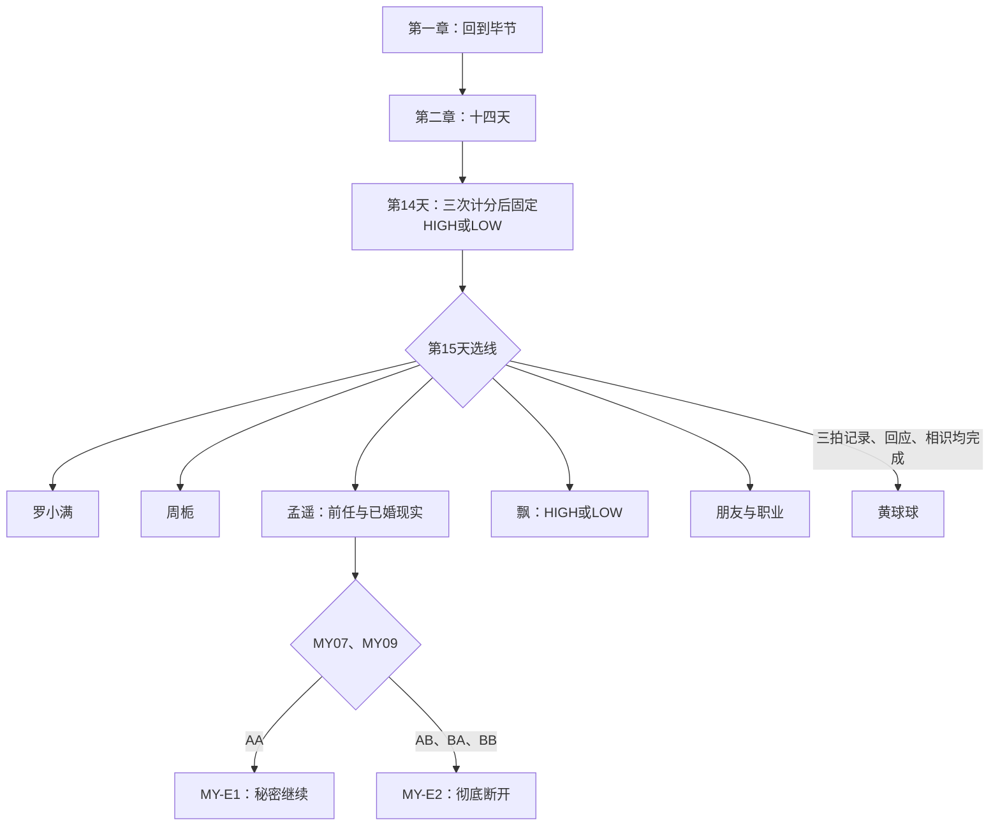

# 六线流程

其余路线及飘分流见 [选择与解锁规则](选择与解锁规则.md)。每条路线独立延续第三至第十章，不能把另一条路线私人事件当作共同前情。关系在共通第14天固定，选线与后续选择不重算；LOW时，飘线读自身第36天事件，非飘五线在各自指定调用点读一次公共事件，再返回该点之后，HIGH跳过。逐线调用与返回锚点见[内容规则契约](../../scenario/规则契约.md)。

叶岚仅存在于朋友群像，无可玩分支。结局后按 [后日谈接续](关系后日谈.md) 读取适用正文。此图是内容说明，未代表引擎可达性验收。
